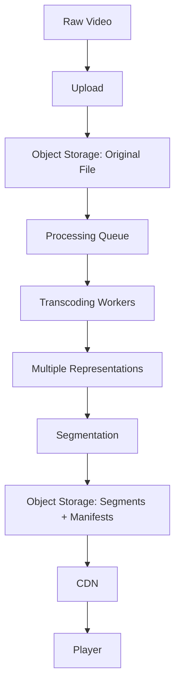
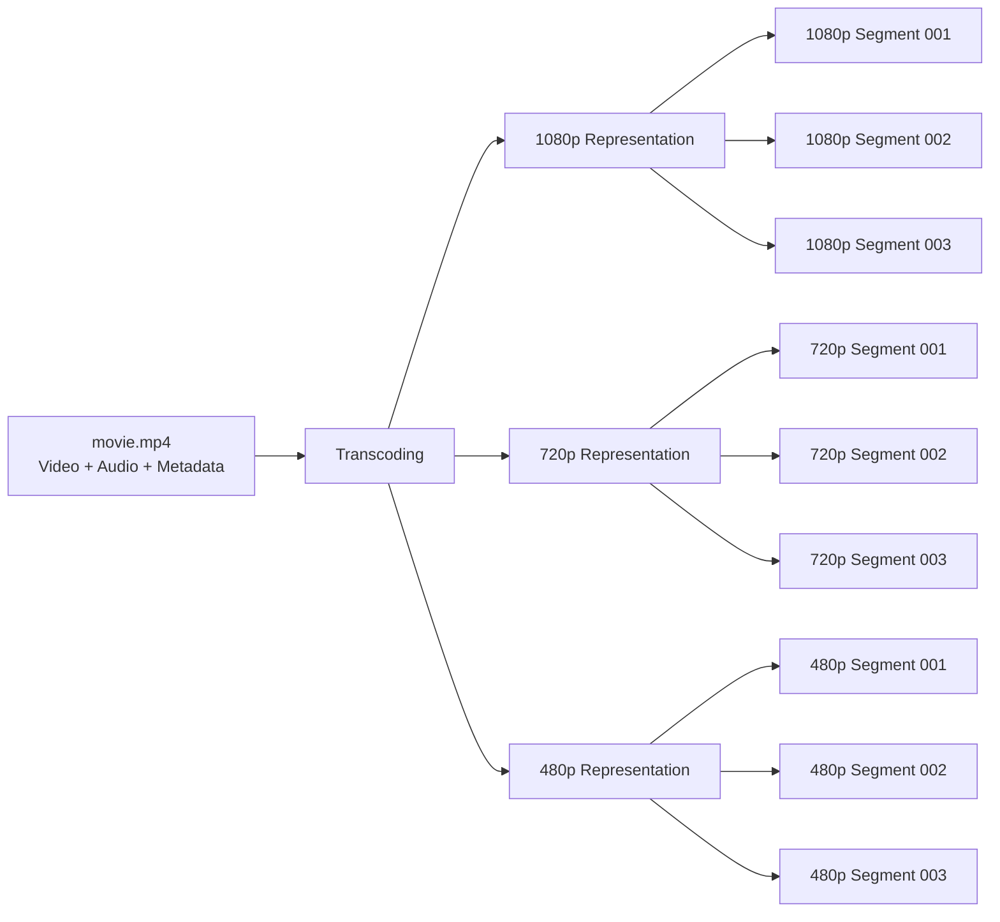
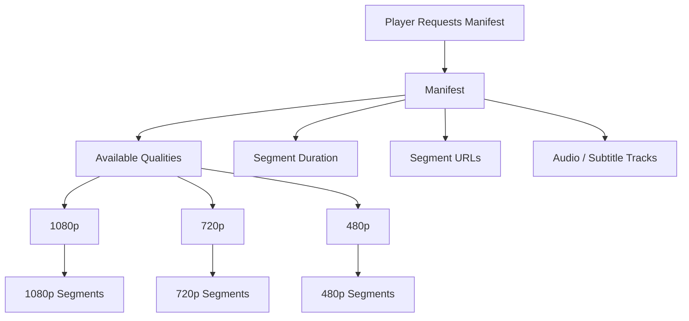
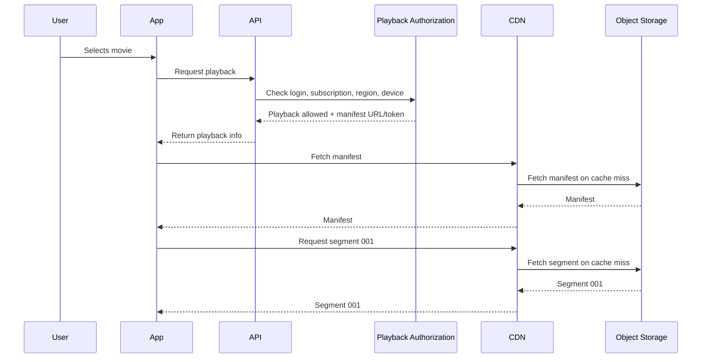
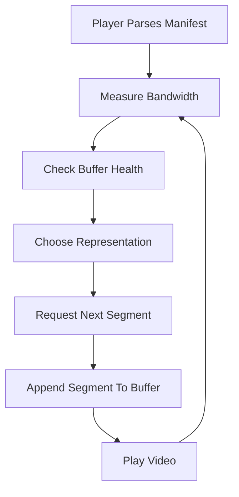
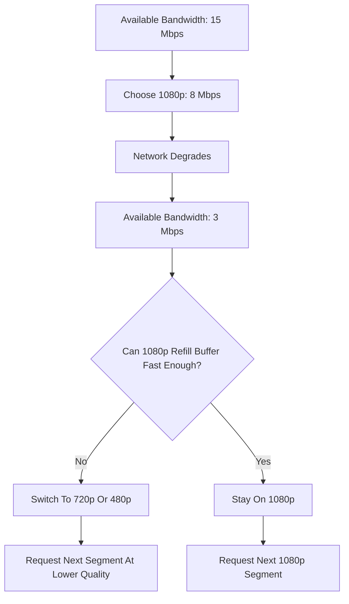
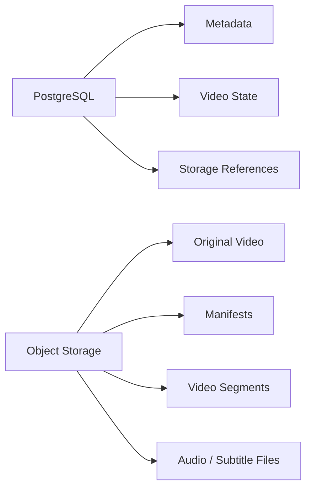
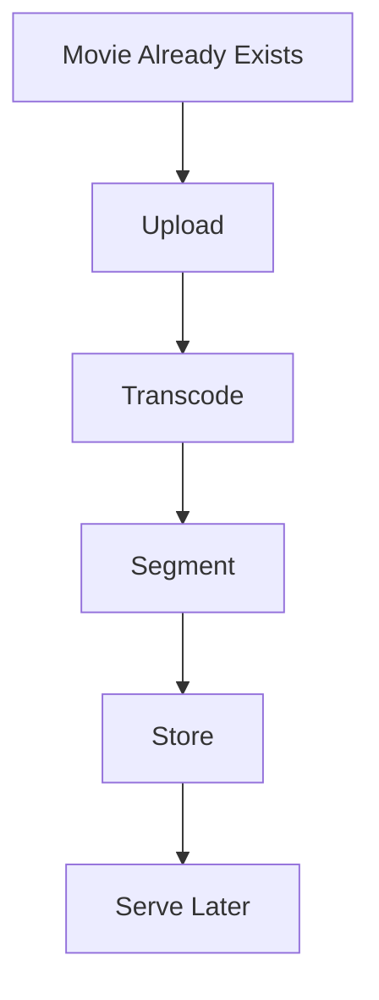
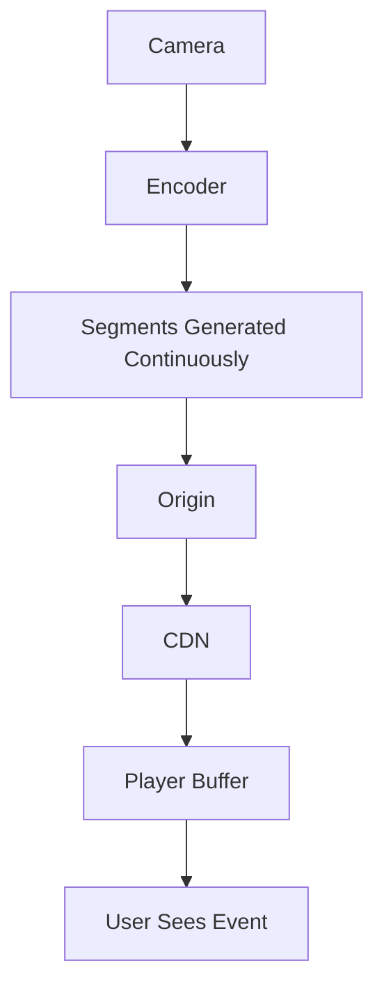
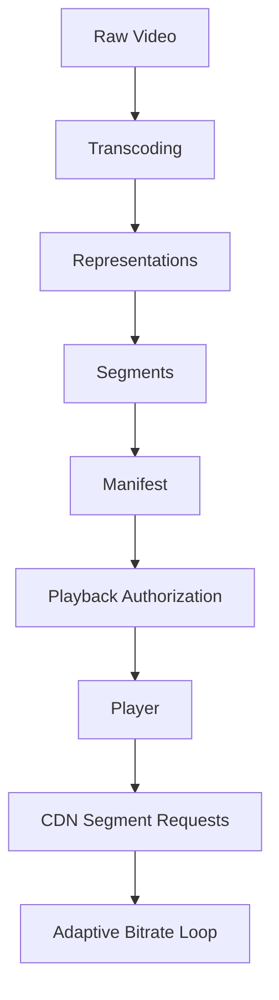

# Layer 1 Flow Diagrams: Ingestion To Playback

Layer 1 is about the basic media path:

```text
Raw video -> upload -> processing -> storage -> CDN -> player
```

The blunt point: the uploaded `movie.mp4` is not what a large streaming app directly serves to every user. It is source material. The platform converts it into streaming-friendly outputs: manifests, multiple qualities, and small segments.

## 1. End-To-End Content Pipeline



### Explanation

The raw video enters the system once, but it is read many times during processing and playback. Object storage is used twice:

- First, to store the original uploaded file.
- Later, to store the generated streaming outputs.

The queue decouples upload from processing. Without a queue, the uploader would have to wait while the system transcodes the whole video.

## 2. Raw MP4 Vs Streaming Output



### Explanation

A single MP4 is inconvenient for streaming at scale because users have different devices, network conditions, and playback behavior.

Streaming output fixes that by creating:

- Multiple qualities: 1080p, 720p, 480p, etc.
- Small segments: short chunks the player can request one by one.
- A manifest: a map that tells the player what exists and where to fetch it.

### Correlation

| Problem | Streaming Feature That Solves It |
|---|---|
| Network drops from 15 Mbps to 3 Mbps | Switch from 1080p to 480p |
| User seeks to 1:32:14 | Request the segment near that timestamp |
| User has a small phone | Start at lower resolution |
| User has a 4K TV | Choose a higher representation if available |
| CDN needs cacheable objects | Cache individual segments instead of huge full files |

## 3. Manifest As The Playback Map



### Explanation

The manifest does not usually contain the video bytes. It describes the video structure.

The player needs the manifest before playback because it must know:

- What qualities are available.
- Where the segments are.
- How long each segment is.
- Which audio and subtitle tracks exist.

The manifest is the bridge between control-plane authorization and data-plane delivery.

## 4. Playback Authorization To Segment Delivery



### Explanation

The API should answer: "Is this user allowed to watch this?"

The CDN should answer: "Can I deliver this segment quickly?"

These are different jobs. Mixing them is how application servers accidentally become video servers.

### Correlation

| Component | Responsibility |
|---|---|
| API | Business decision: who can watch what |
| Playback authorization | Entitlement, subscription, region, device checks |
| Manifest | Playback map |
| CDN | Fast delivery and caching |
| Object storage | Durable source of generated media files |
| Player | Chooses what to request next |

## 5. Player Playback Loop



### Explanation

Playback is not a single download. It is a loop.

The player repeatedly measures network speed and buffer health, then chooses the next segment. This is why one movie can start at 1080p and later continue at 480p without restarting.

## 6. Adaptive Bitrate Decision Flow



### Explanation

The player is trying to avoid buffering. If the buffer is draining faster than new data arrives, quality must drop.

Example bitrate ladder:

| Quality | Approx Bitrate |
|---|---:|
| 1080p | 8 Mbps |
| 720p | 5 Mbps |
| 480p | 2 Mbps |
| 360p | 800 Kbps |

If available bandwidth is around 3 Mbps, 1080p is a bad choice even if the screen supports it. The player should prefer 480p or a conservative 720p only if buffer health is strong.

## 7. Database Vs Object Storage



### Explanation

Do not store video segments in PostgreSQL. Store metadata and references there.

Use the database for:

- Video title, duration, status.
- Processing state.
- Manifest URI.
- Representation metadata.

Use object storage for:

- Original uploaded files.
- Generated segments.
- Manifests.
- Audio and subtitle assets.

The correlation is simple: database rows describe media; object storage contains media.

## 8. VOD Flow Vs Live Flow

### Video-On-Demand



### Live Streaming



### Explanation

VOD has a finished source file. The platform can process it ahead of time.

Live content is still being created while users are watching. The pipeline never stops during the event.

This introduces a new metric: end-to-end latency.

```text
Camera capture
  -> encoding
  -> segment creation
  -> origin
  -> CDN
  -> player buffer
  -> user sees event
```

If this takes 20 seconds, the viewer sees the event 20 seconds late. For sports, that delay matters.

## 9. Layer 1 Summary



Layer 1 teaches the core streaming idea:

- The uploaded file is not the final playback format.
- The system creates multiple quality levels.
- Each quality is split into segments.
- The manifest tells the player how to find those segments.
- The API authorizes playback.
- The CDN delivers media bytes.
- The player continuously adapts based on network and buffer conditions.

Once this is clear, the next layer should go deeper into live streaming, latency, and how segment size affects the user experience.
