# Layer 2 Flow Diagrams: Scaling One Million Viewers

Layer 2 explains a critical scaling idea:

```text
1 million users does not mean every component receives the same load.
```

In a streaming platform, user traffic splits into different workload types. Each workload scales differently and needs a different architecture.

## 1. One Million Viewers Is Multiple Traffic Types

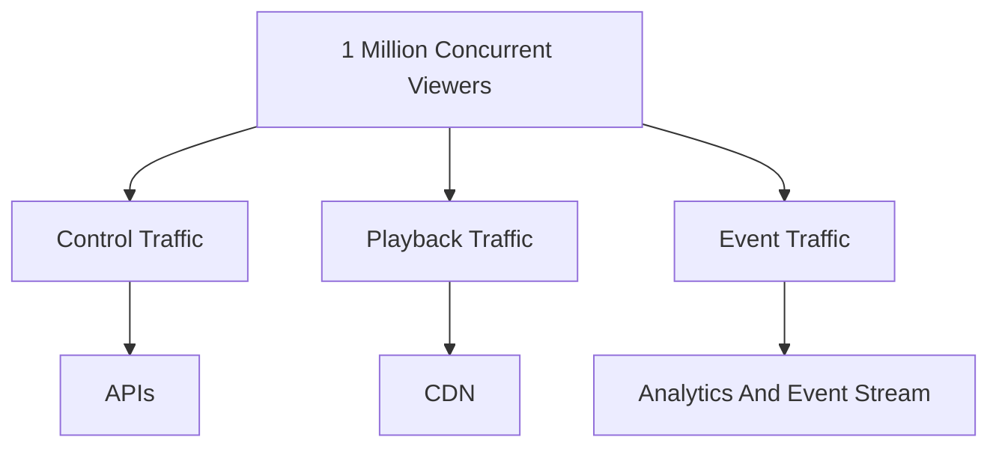

### Explanation

When someone says "1 million users", do not immediately scale every service by the same amount. First split the traffic.

Control traffic is app behavior:

- `GET /home`
- `GET /catalog`
- `GET /profile`
- `GET /recommendations`
- `POST /login`
- `POST /playback`

Playback traffic is media delivery:

- Manifest requests
- Video segment requests
- Audio segment requests
- Subtitle requests

Event traffic is user behavior data:

- Playback started
- Playback paused
- 30 seconds watched
- Search performed
- Recommendation clicked
- Playback abandoned

These three flows have different scale, latency, durability, and storage requirements.

## 2. Control Plane Scaling

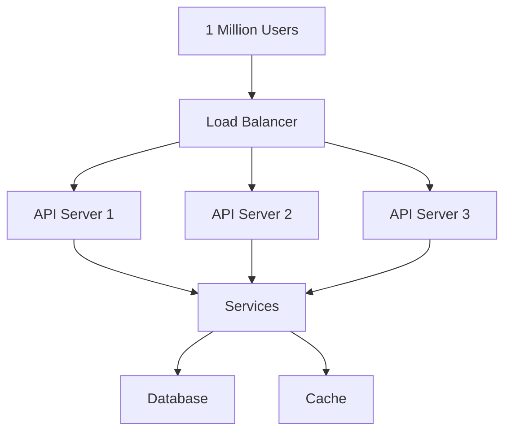

### Explanation

Control plane requests are usually small compared with video traffic. You can horizontally scale stateless API servers behind a load balancer.

The key word is stateless.

API servers should not keep critical user session or application state only in memory. If an API server dies, another server should handle the next request.

### Correlation

| Requirement | Design Choice |
|---|---|
| Handle more API requests | Add more API servers |
| Avoid losing sessions on server failure | Store session state externally |
| Avoid repeated database reads | Add Redis or another cache |
| Keep deployment simple early | Start with a monolith behind a load balancer |

## 3. Playback Traffic Is Much Larger

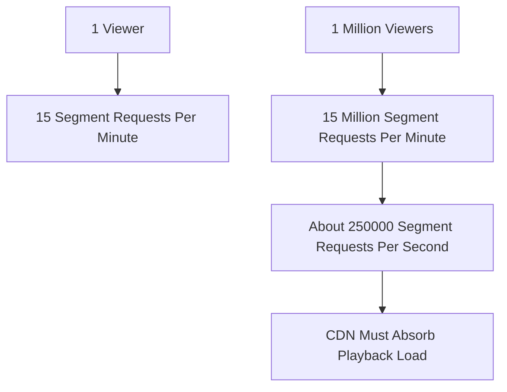

### Explanation

Playback traffic explodes because video is not one request. A player continuously asks for segments.

If one viewer requests 15 segments per minute:

```text
15 segments/minute * 1,000,000 viewers = 15,000,000 segment requests/minute
15,000,000 / 60 = 250,000 segment requests/second
```

This traffic should not hit your API servers. It should go to the CDN.

## 4. CDN Cache Hit And Miss Flow

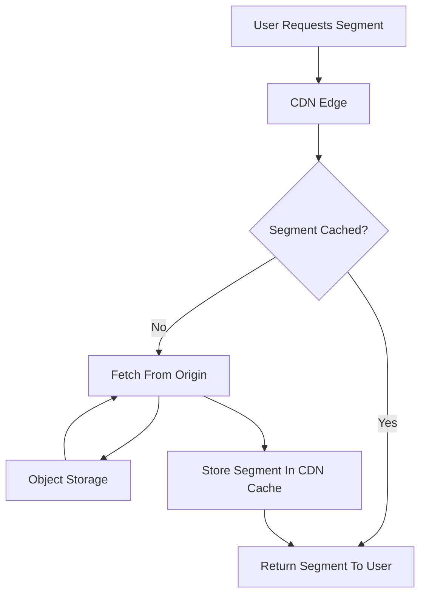

### Explanation

A cache hit means the CDN already has the segment near the user. The origin is not touched.

A cache miss means the CDN must fetch the segment from origin or object storage, cache it, and then return it.

At large scale, cache hit ratio is survival. If too many requests miss cache, the origin gets hammered.

## 5. Cache Locality

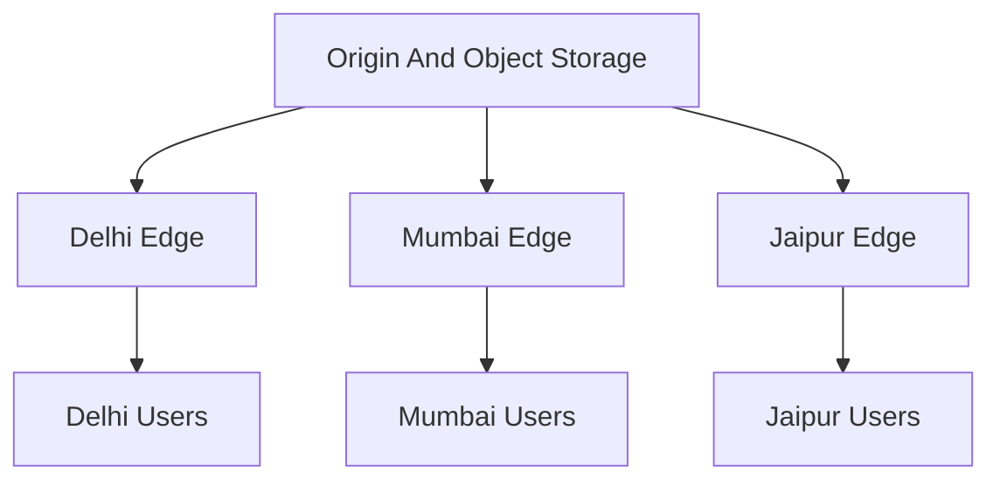

### Explanation

CDN edges keep content close to users.

This improves:

- Latency: users fetch from a nearby edge.
- Throughput: many edge servers share the load.
- Origin protection: repeated segment requests do not all hit storage.

### Correlation

| Without CDN Locality | With CDN Locality |
|---|---|
| Every region pulls from origin | Nearby edge serves users |
| High origin bandwidth cost | Lower origin load |
| Higher playback startup delay | Faster segment fetches |
| Regional spikes hurt origin | Edge absorbs local demand |

## 6. Live Streaming Cache Tension

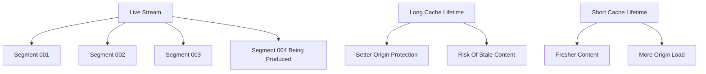

### Explanation

Live streaming creates a conflict:

```text
Freshness vs scalability
```

If you cache too aggressively, users may see stale content. If you do not cache enough, origin gets overloaded.

For live, you are constantly balancing:

- Consistency
- Freshness
- Latency
- Scalability
- Origin protection

This is harder than video-on-demand because the newest segment is being created while users are asking for it.

## 7. API Layer Responsibility

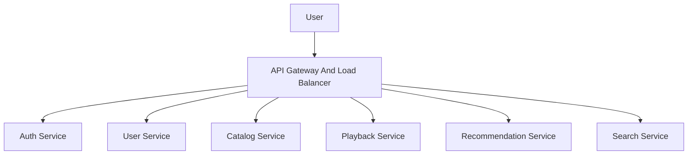

### Explanation

The API layer should not contain video bytes.

Its job is control:

- Authenticate the user.
- Fetch user data.
- Fetch catalog data.
- Authorize playback.
- Return manifest or playback information.
- Serve recommendations.
- Search metadata.

The API gives permission and metadata. The CDN serves media.

## 8. Monolith First, Services Later

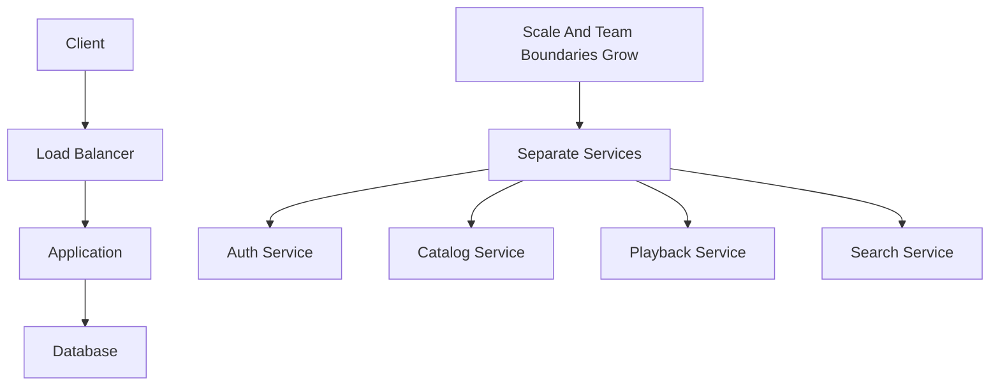

### Explanation

Do not jump to microservices just because the final Hotstar-like architecture has many services.

At the beginning, a monolith is fine:

```text
Client -> Load Balancer -> Application -> Database
```

Split into services when scale, ownership, deployment, or fault isolation requires it.

The architectural principle matters more than premature service splitting:

```text
Separate responsibilities. Keep APIs stateless. Keep media out of API servers.
```

## 9. Stateless API Servers

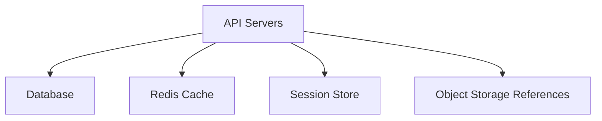

### Explanation

API servers should be replaceable.

Persistent state should live outside them:

- Database
- Cache
- Session store
- Object storage

If an API server has important local-only state, horizontal scaling becomes messy. Requests from the same user may land on different servers.

## 10. Redis For Application Data

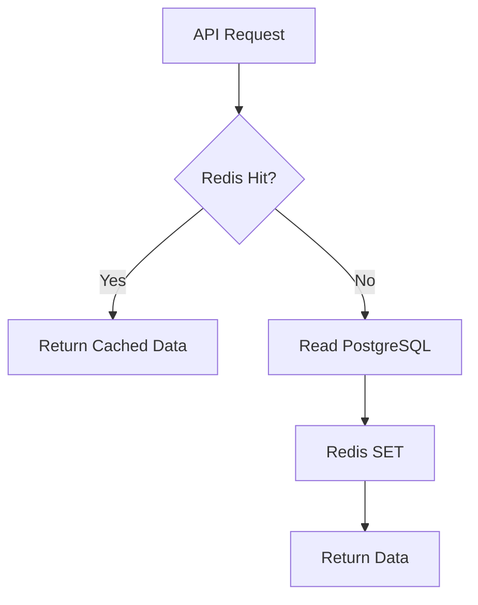

### Explanation

For repeated reads like home page data, catalog metadata, profile info, or recommendations, the API should not always hit PostgreSQL.

Typical flow:

```text
API -> Redis?
  HIT  -> return
  MISS -> PostgreSQL -> Redis SET -> return
```

Redis caches application data. CDN caches media and HTTP-deliverable assets.

## 11. Redis Vs CDN

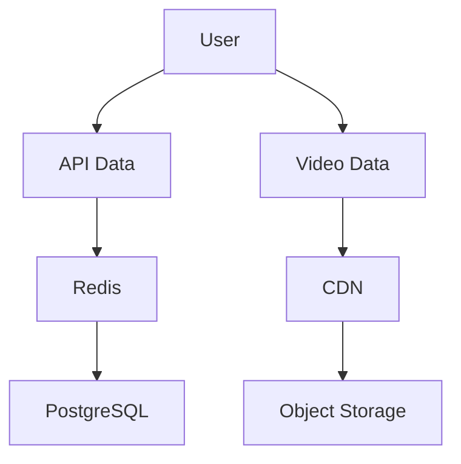

### Explanation

Redis and CDN are both caches, but they cache different things.

| Cache | Caches | Used By | Protects |
|---|---|---|---|
| Redis | Application data | API servers | PostgreSQL |
| CDN | Media and static HTTP assets | Players / browsers | Object storage / origin |

Do not confuse them. Redis is not for video segments. CDN is not your application database cache.

## 12. Event Processing

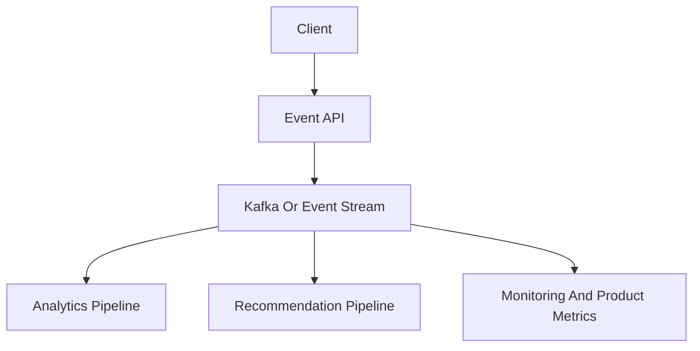

### Explanation

User events should not synchronously hit PostgreSQL one by one.

Examples:

- User started playback.
- User paused.
- User watched 30 seconds.
- User completed an episode.
- User skipped.
- User searched.
- User clicked a recommendation.
- User abandoned playback.

These are high-volume write events. Send them to an event stream like Kafka, then process them asynchronously.

### Correlation

| Event Type | Downstream Use |
|---|---|
| Playback started | Engagement analytics |
| Watched 30 seconds | Watch-time metrics |
| Completed episode | Continue watching / recommendations |
| Search performed | Search ranking improvements |
| Recommendation clicked | Ranking feedback |
| Abandoned playback | Quality or content analysis |

## 13. Layer 2 Architecture

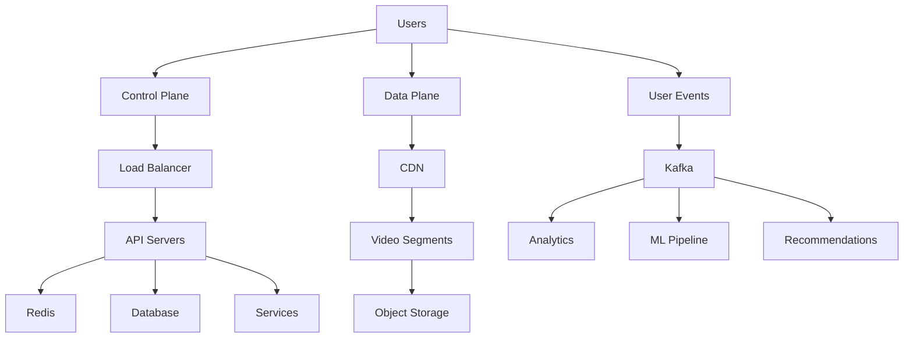

### Explanation

Layer 2 adds the missing scaling split:

- Control plane scales through load-balanced stateless APIs.
- Video delivery scales through CDN and object storage.
- Event processing scales through Kafka and asynchronous pipelines.

## 14. Four Workloads

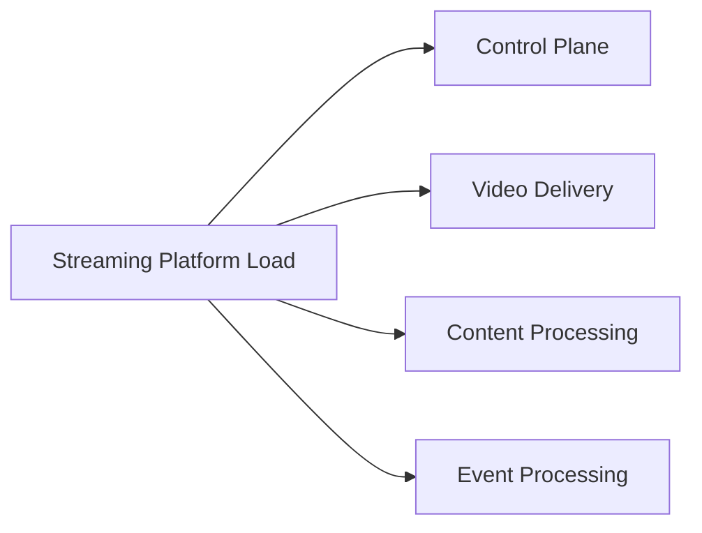

### Explanation

The four main workloads are:

| Workload | Example | Primary Scaling Tool |
|---|---|---|
| Control plane | Login, catalog, playback auth | Stateless API servers + caches |
| Video delivery | Segment requests | CDN |
| Content processing | Transcoding and segmentation | Queues + workers |
| Event processing | Watch events, clicks, searches | Kafka + async consumers |

The number of users is not the same thing as load on every component. Good architecture starts by asking which workload is growing.

## Layer 2 Summary

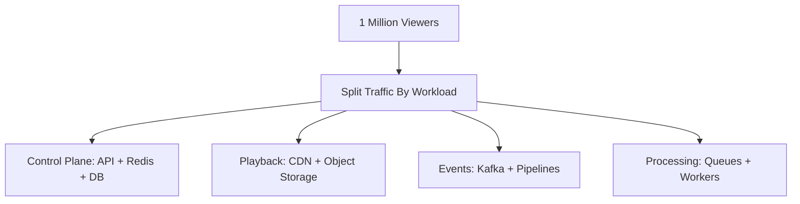

Layer 2 teaches:

- Scale control traffic and video traffic differently.
- Keep API servers stateless.
- Use Redis for hot application data.
- Use CDN for media delivery.
- Use Kafka or an event stream for high-volume user behavior events.
- Avoid premature microservices, but separate responsibilities early.
- Think in workloads, not just user count.
